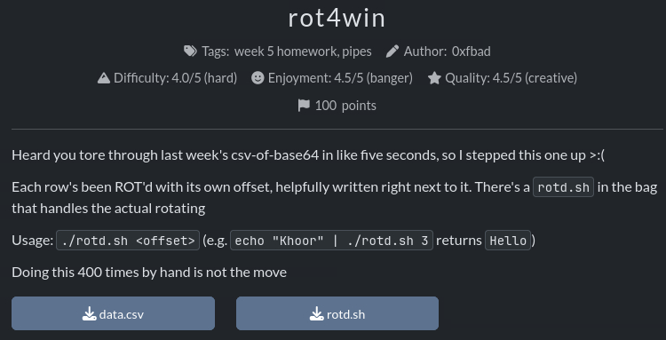
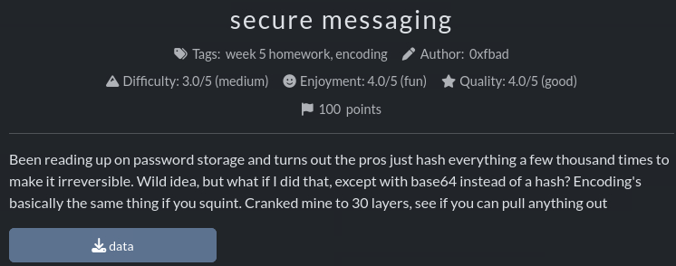
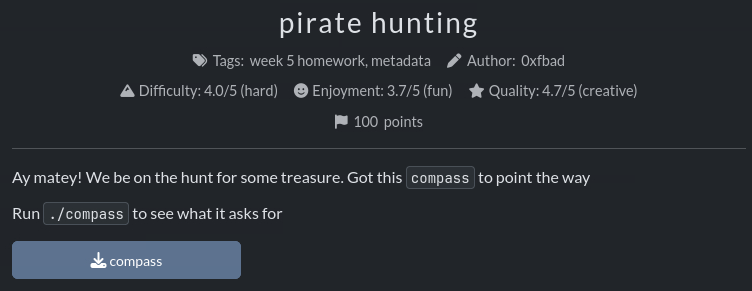

These are the writeups I did for my Intro to Hacking Class at UCSC Midterm. I figured it'd be fun to publish them here so enjoy reading them.

## rot4win


This challenge gave us the files data.csv and rotd.sh.

data.csv was formatted like:
`rot#,randomData`

The challenge tells us that rotd.sh needs to be used like:
`./rotd.sh <offset>` (e.g. `echo "Khoor" | ./rotd.sh 3` returns `Hello`)

This means that we needed to iterate through every line (there are a lot of lines) and use the individual ROT value for each line.

My very first step was to use `chmod +x rotd.sh` to allow us to run the script.

To do this my logic was: lets use `awk` to take the first field of each line and input it into the command.

With some quick google searches I discovered that you can use `system()` in your `awk` code to run terminal commands. 

With this information I put together the command:
`awk -F ',' '{system("echo " $2 " | ./rotd.sh " $1) }' data.csv`

Lets break this command down:

`awk` - the command obviously lol.

`-F ','` -  set the field separator of the command to `,`, which allows us to interact with the first field (the rot #) and the second field (the data) as variables `$1` and `$2` in the rest of the command.

`'{system(` - declare the awk code and use the `system()` function to run Linux commands.

`"echo " $2 "` - `echo` the second field of the data of each line `$2`. This is the data we want to ROT with the script. We need to `echo` it so we can actually input every line into the script.

`|` - we use this to pipe the output of the `echo` command into the second command.

`./rotd.sh " $1) }'` - run the script `./rotd.sh` and input the first variable `$1` into it because the argument it takes is the number of characters the ROT cipher rotates when decoding.

`data.csv` - our data file

After running this we get a ton of random data constantly. There was probably a more efficient way I could have done this but as it was outputting the data I noticed the flag and was able to just copy it from the terminal output.

If I were to make this more efficient I would probably figure out a way to have it just output the flag but otherwise this felt like a pretty valid solution.

## secure messaging



We were given the file `data` which is a very large base64 encoded file. If we read the challenge description we notice that it says the flag has been encoded 30 times.

My initial attempt was to use a script to recursively decode the file until it output the file so I tried to create a script. I tried to make a few iterations of this script but I was unable to get it to actually output the flag. I don't exactly know why but I decided to just move on to a less elegant solution.

This less elegant solution was to literally just pipe the `base64 -d` command into itself 30 times.

The actual command I ended up using was:
```
base64 -d data | base64 -d | base64 -d | base64 -d | base64 -d | base64 -d | base64 -d | base64 -d | base64 -d | base64 -d | base64 -d | base64 -d | base64 -d | base64 -d | base64 -d | base64 -d | base64 -d | base64 -d | base64 -d | base64 -d | base64 -d | base64 -d | base64 -d | base64 -d | base64 -d | base64 -d | base64 -d | base64 -d | base64 -d | base64 -d
```

Which output:
`Nation agent reach knowledge of. cmpm{n07_qu173_pbkdf2_ogx205}`

I understand that this is not probably the intended solution as creating a script would have been more elegant, but it did only take me like 20 seconds to copy paste `base64 -d` 30 times and I did get the flag. In the future I would like to spend more time learning how to properly write a script to solve it.


## pirate hunting



With this challenge we were given the executable `compass`.

To start I used `chmod +x compass` to make it able to be ran as a program.

When you run `./compass` you are given the output:
`Usage: ./compass <file>`

When I tried to use compass with another file I was given the output:
```
ImageDescription field is missing.
Artist field is missing.
Copyright field is missing.
Make field is missing.
Model field is missing.
Software field is missing.
DocumentName field is missing.
```

This slightly confused me so I continued to try to use the script with a few other files and was given the same output. Until I ran: `./compass /` which output:
```
Yer ImageDescription should be marked 'X marks the spot'...
Yer Artist should be signed by 'Cpt. Long John Silver'...
Yer Copyright should bear the warning 'Hands Off The Loot'...
Yer Make should be captured by 'Hispaniola'...
Yer Model should be sighted through a 'Brass Sextant'...
Yer Software should be charted with 'DeadReckoner v0.8.2'...
Yer DocumentName should be a 'Captain's Chart'...
```

I then deduced from this that I was probably supposed to use `exiftool` to modify a file to meet these fields.

I used `hx empty` to create an empty text file so I had a file to modify the metadata of.

I then ran: 
```
exiftool -ImageDescription="X marks the spot" -Artist="Cpt. Long John Silver" -Copyright="Hands Off The Loot" -Make="Hispaniola" -Model="Brass Sextant" -Software="DeadReckoner v0.8.2" -DocumentName="Captain's Chart" empty
```

This output:
```
Error: Writing of this type of file is not supported - empty
    0 image files updated
    1 files weren't updated due to errors
```

This made me realize that I needed to use an image file and not a text file. So I downloaded a random image file from google and named it `png.png`.

With this new `png` I was able to re-run the last command and replace `empty` with `png.png`:
```
exiftool -ImageDescription="X marks the spot" -Artist="Cpt. Long John Silver" -Copyright="Hands Off The Loot" -Make="Hispaniola" -Model="Brass Sextant" -Software="DeadReckoner v0.8.2" -DocumentName="Captain's Chart" png.png
```

This output:
```
    1 image files updated
```

This made me think that I succeeded in changing the metadata.

I then assumed that `./compass` wanted me to input the new modified image so I ran: `./compass png.png` which output:
```
Aye.
Aye.
Aye.
Aye.
Aye.
Aye.
Aye.
Arrr! Here be the flag: cmpm{f4k3_1t_t1ll_y0u_m4k3_1t}
```

Woah that's the flag!

This challenge was fairly easy once I figured out that compass wanted me to change the metadata of an image.